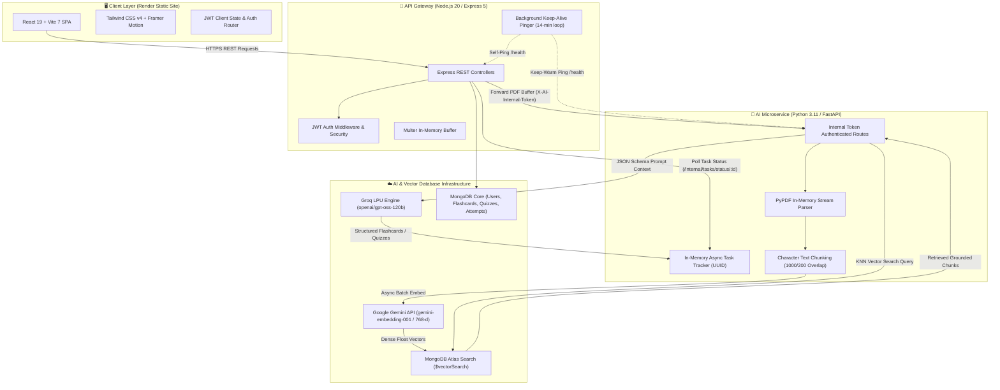
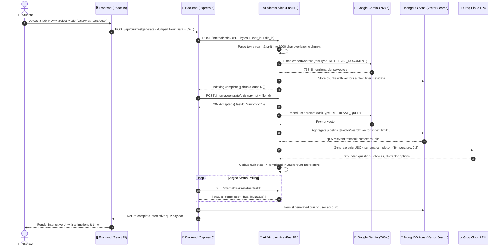

<div align="center">

# 🎓 StudySnap
### **Autonomous AI-Powered Exam Preparation & Active Recall Learning System**

Transform unstructured study notes, textbook chapters, and syllabus PDFs into interactive, curriculum-grounded quizzes, flashcards, and exam papers in seconds.

---

<!-- Top Quick Links Badge Hub -->
<p align="center">
  <a href="https://studysnap-frontend-ca13.onrender.com/" target="_blank">
    
  </a>
  <a href="https://studysnap-backend-xcjg.onrender.com/health" target="_blank">
    
  </a>
  <a href="https://studysnap-ai-w7ss.onrender.com/health" target="_blank">
    
  </a>
</p>

<!-- Media Badges: Video & Drive Links -->
<p align="center">
  <a href="https://www.youtube.com/watch?v=jc-SEWqL3JQ" target="_blank">
    
  </a>
  <a href="https://drive.google.com/drive/folders/sample-studysnap-docs" target="_blank">
    
  </a>
</p>

<!-- Tech Stack Badges -->
<p align="center">
  
  
  
  
  
  
  
  
  
  
</p>

---

<p align="center">
  <a href="https://www.youtube.com/watch?v=jc-SEWqL3JQ" target="_blank">
    
  </a>
</p>

</div>

---

## 🌐 Live Deployments & Endpoints

All services are deployed and orchestrated on **Render Cloud** in high-availability mode with automated health monitoring:

| Component | Service Type | Deployment URL | Healthcheck / Status |
| :--- | :--- | :--- | :--- |
| **Frontend UI** | Static Site (CDN) | [`https://studysnap-frontend-ca13.onrender.com`](https://studysnap-frontend-ca13.onrender.com/) | Global Edge CDN (Always Online) |
| **Backend API Gateway** | Node/Express Web Service | [`https://studysnap-backend-xcjg.onrender.com`](https://studysnap-backend-xcjg.onrender.com/) | [`/health`](https://studysnap-backend-xcjg.onrender.com/health) (JSON `{ "ok": true }`) |
| **AI Processing Microservice** | Python/FastAPI Web Service | [`https://studysnap-ai-w7ss.onrender.com`](https://studysnap-ai-w7ss.onrender.com/) | [`/health`](https://studysnap-ai-w7ss.onrender.com/health) (JSON `{ "ok": true }`) |
| **Sample Material Hub** | Document Drive | [`Sample Study Notes`](https://drive.google.com/drive/folders/sample-studysnap-docs) | Verified PDF test sheets |

---

## 💡 What is StudySnap?

Traditional exam preparation suffers from the **illusion of competence**: passively re-reading static textbooks yields weak retention. Cognitive science demonstrates that **active recall** and **spaced retrieval** generate the highest long-term memory consolidation.

**StudySnap** is an autonomous RAG (Retrieval-Augmented Generation) educational engine that bridges the gap between passive reading and active mastering. By ingesting complex PDFs, breaking them into semantic chunks, mapping their dense representations in a 768-dimensional vector space, and performing zero-shot grounded reasoning via Groq LPUs, StudySnap turns any PDF into tailored study tools in seconds without hallucinations.

---

## 🏛️ System Architecture

StudySnap employs a decoupled, production-grade microservices architecture designed for resilience, zero cold-starts, and sub-second generation throughput:



---

## 🔄 End-to-End RAG Ingestion & Generation Pipeline



---

## ✨ Core Features & Functional Deep-Dive

### 1. 🗂️ Intelligent Flashcard Engine
* **Active Recall Optimization**: Automatically extracts key terminology, definitions, and contrasting concepts from uploaded course material.
* **Query Expansion Algorithm**: When the user requests definitions, the vector search query is mathematically expanded with synonyms (`terminology, glossary, concepts, meaning`) to boost semantic recall.
* **Interactive 3D Flip Cards**: Sleek UI powered by Framer Motion, enabling users to test their knowledge, track mastery status, and navigate card stacks seamlessly.

### 2. 🎯 Contextual MCQ Quiz Builder
* **Document-Grounded Questions**: Every question is synthesized strictly from retrieved context chunks, preventing hallucination of facts not covered in your syllabus.
* **Smart Distractor Generation**: Uses low-temperature generation (`T = 0.2`) to formulate realistic multiple-choice options with exactly one verifiably correct answer.
* **Instant Evaluation & Feedback**: Immediate scoring, answer reveal animations, and detailed performance reviews upon quiz completion.

### 3. 📝 Dynamic Exam Q&A Paper Generator
* **Mark Weightage Distribution**: Customize question allocations to mirror your exact university or board examination formats (e.g., 5 questions of 2 marks each, 3 questions of 5 marks, and 2 questions of 10 marks).
* **Adaptive Depth of Answers**: High-mark questions (10+ marks) trigger structured, multi-paragraph analytical responses from the text, while short-mark questions produce concise, bulleted definitions.

### 4. 📈 Gamified Analytics & Retention Dashboard
* **Study Streaks**: Tracks daily learning activity and continuous study streaks to drive habit formation.
* **Attempt History**: Records previous quiz scores, timestamped attempts, and progress curves over time.
* **Stored Collections**: Revisit, retake, or export previously generated quizzes and flashcard decks at any time.

### 5. 🛡️ High-Availability & Free-Tier Cold-Start Elimination
* **Dual Keep-Alive Pinger**: Built-in background timer (`startKeepAlivePinger`) in Express pings both the backend and FastAPI instances every 14 minutes when `NODE_ENV=production`.
* **Zero 429 Throttling**: Eliminates free-tier sleep cycles that would otherwise cause simultaneous cold-start traffic spikes against downstream AI providers.

---

## 🛠️ Complete Technology Stack

```text
StudySnap Full-Stack Ecosystem
├── Presentation Layer (Frontend)
│   ├── Framework: React 19 (Hooks, Context API, Suspense)
│   ├── Tooling: Vite 7 (Hot Module Replacement, ESM Build)
│   ├── Styling: Tailwind CSS v4 (Modern CSS theme variables, zero-runtime)
│   ├── Motion: Framer Motion 12 (Spring physics, modal backdrops, card flips)
│   ├── Icons: @heroicons/react 2.2
│   └── Routing: React Router DOM v7 (Protected authentication layout)
│
├── API Gateway & Orchestration (Backend)
│   ├── Runtime: Node.js 20.x LTS
│   ├── Server: Express 5.1 (RESTful JSON API, global CORS)
│   ├── Persistence: Mongoose 8.19 + MongoDB Native Driver 7.1
│   ├── Ingestion: Multer 2.0 (In-Memory Buffer Streaming)
│   ├── Security: JSON Web Tokens (jsonwebtoken 9.0) + BcryptJS 3.0
│   └── Background Keepalive: Periodic fetch monitor (AbortSignal timeout)
│
├── AI Retrieval & Processing Engine (ai-fastapi)
│   ├── Runtime: Python 3.11+
│   ├── Framework: FastAPI 0.115 (Asynchronous ASGI server)
│   ├── Server: Uvicorn Standard 0.35
│   ├── HTTP Client: HTTPX 0.28 (Async connection pool & retry backoff)
│   ├── PDF Extraction: PyPDF 5.5 (In-memory byte-stream parser)
│   ├── Mongo Client: PyMongo 4.13 ($vectorSearch aggregation)
│   └── Concurrency: FastAPI BackgroundTasks with in-memory UUID token store
│
└── Cloud & Intelligence Providers
    ├── Vector Embeddings: Google Gemini API (gemini-embedding-001, 768 Dimensions)
    ├── LLM Inference: Groq LPU Cloud (openai/gpt-oss-120b, ultra-low latency)
    ├── Vector Database: MongoDB Atlas (M0/M10 Tier with HNSW Vector Index)
    └── Deployment: Render (Static Site CDN, Node Web Service, Python Web Service)
```

---

## 📂 Project Directory Structure

```text
StudySnap/
├── ai-fastapi/                   # 🧠 FastAPI Python AI Processing Microservice
│   ├── app/
│   │   ├── providers/
│   │   │   ├── gemini_embeddings.py # Gemini 768-d vector embedding client with retries
│   │   │   └── groq_chat.py         # Groq chat completion client with retry-after handler
│   │   ├── ai.py                    # RAG pipeline: chunking, vector indexing, retrieval logic
│   │   ├── config.py                # Pydantic/dataclass environment settings & validation
│   │   ├── main.py                  # FastAPI route declarations, lifespan, async task store
│   │   ├── mongo.py                 # PyMongo connection singleton & chunk vector operations
│   │   ├── pdf_utils.py             # Memory-efficient PyPDF text extraction helpers
│   │   └── text_utils.py            # Sliding window overlapping character splitter
│   ├── .env.example                 # Reference environment template for FastAPI service
│   ├── README.md                    # FastAPI specific execution guide
│   └── requirements.txt             # Locked Python production dependencies
│
├── backend/                      # 🚪 Node.js / Express Core Backend Gateway
│   ├── controllers/
│   │   ├── auth.controller.js       # Register, login, keep-warm cron endpoints
│   │   ├── dashboard.controller.js  # User statistics, streak calculation, recent activity
│   │   ├── flashcard.controller.js  # Flashcard set creation, retrieval, and deletion
│   │   ├── qa.controller.js         # Marks-weighted Q&A exam set generation & retrieval
│   │   └── quiz.controller.js       # Quiz generation, attempt submission, scoring logic
│   ├── middleware/
│   │   └── auth.middleware.js       # Bearer JWT verification & Cron-Secret authorization
│   ├── models/
│   │   ├── chunk.model.js           # Mongoose schema for document text vectors
│   │   ├── flashcardSet.model.js    # Flashcard deck schema with cards array
│   │   ├── qaSet.model.js           # Exam Q&A document schema with mark metadata
│   │   ├── quiz.model.js            # Quiz definition schema with questions and choices
│   │   ├── quizAttempt.model.js     # User submission records and score tracking
│   │   └── user.model.js            # User credentials, streak counter, timestamps
│   ├── routes/                      # Express route definitions mapped to controllers
│   ├── services/
│   │   ├── ai.service.js            # Fallback direct LangChain AI pipeline
│   │   ├── aiFastApi.client.js      # Robust HTTP client communicating with ai-fastapi
│   │   └── quiz.service.js          # In-memory quiz session scoring engine
│   ├── .env.example                 # Reference environment template for Node backend
│   ├── package.json                 # Node dependencies and build scripts
│   └── server.js                    # Express bootstrap, Mongoose connect, keep-alive pinger
│
├── frontend/                     # 🖥️ React 19 + Vite 7 Single Page Application
│   ├── public/                      # Static assets, web manifest, favicon
│   ├── src/
│   │   ├── components/
│   │   │   ├── MobileNav.jsx        # Mobile responsive navigation bar & menu toggle
│   │   │   └── SideBar.jsx          # Desktop sidebar navigation with user profile badge
│   │   ├── pages/
│   │   │   ├── DashboardPage.jsx    # Analytics overview, streak metrics, quick action cards
│   │   │   ├── FlashcardPage.jsx    # Interactive 3D flip card active recall viewer
│   │   │   ├── LandingPage.jsx      # High-conversion hero landing, auth modal, demo showcase
│   │   │   ├── QAPage.jsx           # Exam paper generator with custom mark distribution
│   │   │   └── QuizPage.jsx         # Interactive timed MCQ quiz engine & score calculator
│   │   ├── App.jsx                  # Root router, protected layout wrapper, auth state
│   │   ├── index.css                # Tailwind CSS v4 styling rules & custom animations
│   │   └── main.jsx                 # React root rendering entrypoint
│   ├── package.json                 # Frontend dependencies
│   ├── vercel.json                  # SPA rewrite configuration rules
│   └── vite.config.js               # Vite build settings & Tailwind v4 plugin integration
│
├── render.yaml                   # 🚀 Render Blueprint (Cron keepalive warmup definitions)
└── README.md                     # 📖 Master Comprehensive Documentation
```

---

## 🔑 Environment Variables Reference

### 1. Backend Service (`backend/.env`)

| Variable | Required | Default / Example | Purpose |
| :--- | :---: | :--- | :--- |
| `PORT` | No | `5001` | Local port for Express API |
| `NODE_ENV` | Yes | `production` | Enables production optimisations and keep-alive pinger |
| `MONGODB_URI` | Yes | `mongodb+srv://<user>:<pwd>@cluster.mongodb.net/studysnap` | MongoDB Atlas cluster connection string |
| `JWT_SECRET` | Yes | `your_crypto_random_32_byte_hex` | Cryptographic secret for signing auth tokens |
| `AI_INTERNAL_TOKEN` | Yes | `shared_secret_hex` | Shared header token authenticating calls to FastAPI |
| `FASTAPI_AI_URL` | Yes | `https://studysnap-ai-w7ss.onrender.com` | Live URL of the deployed FastAPI service |
| `FASTAPI_TIMEOUT_MS` | No | `120000` | HTTP timeout (in ms) when waiting for AI responses |
| `CRON_SECRET` | Yes | `cron_secret_hex` | Protects `/api/auth/ai-warmup/cron` endpoint |
| `GROQ_API_KEY` | Yes | `gsk_...` | API key for Groq Cloud LPU inference |
| `GROQ_MODEL` | No | `openai/gpt-oss-120b` | Model identifier for Groq text generation |
| `GEMINI_API_KEY` | Yes | `AIzaSy...` or `AQ....` | Google Generative Language API key for embeddings |
| `BACKEND_URL` | Yes (in prod) | `https://studysnap-backend-xcjg.onrender.com` | Self-ping target for Render free-tier keep-alive |

### 2. AI Microservice (`ai-fastapi/.env`)

| Variable | Required | Default / Example | Purpose |
| :--- | :---: | :--- | :--- |
| `AI_INTERNAL_TOKEN` | Yes | `shared_secret_hex` | Must match backend `AI_INTERNAL_TOKEN` exactly |
| `MONGODB_URI` | Yes | `mongodb+srv://<user>:<pwd>@cluster.mongodb.net/studysnap` | MongoDB connection for writing chunk vectors |
| `MONGODB_DB` | Yes | `studysnap` | Explicit database name targeted by PyMongo |
| `GROQ_API_KEY` | Yes | `gsk_...` | API key for Groq LPU completions |
| `GROQ_MODEL` | No | `openai/gpt-oss-120b` | Active model on Groq (`openai/gpt-oss-120b` / `20b`) |
| `GROQ_BASE_URL` | No | `https://api.groq.com/openai/v1` | OpenAI-compatible Groq API endpoint base |
| `GEMINI_API_KEY` | Yes | `AIzaSy...` or `AQ....` | Google Gemini key for generating vector embeddings |
| `GEMINI_EMBEDDING_MODEL`| No | `gemini-embedding-001` | Target Google embedding model |
| `GEMINI_BASE_URL` | No | `https://generativelanguage.googleapis.com/v1beta` | Google Generative AI API version base URL |
| `GEMINI_TASK_TYPE` | No | `RETRIEVAL_DOCUMENT` | Task type optimization for document indexing |
| `EMBEDDING_DIMENSIONS` | No | `768` | Vector dimensionality matching the Atlas Search index |
| `VECTOR_INDEX_NAME` | No | `vector_index` | Name of the Atlas Vector Search index in MongoDB |
| `HTTP_TIMEOUT_S` | No | `60` | HTTP client timeout in seconds |
| `EMBEDDING_CONCURRENCY`| No | `4` | Max concurrent embedding batch requests |
| `EMBEDDING_MAX_RETRIES`| No | `4` | Retry count for transient API rate-limits |

### 3. Frontend Application (`frontend/.env`)

| Variable | Required | Default / Example | Purpose |
| :--- | :---: | :--- | :--- |
| `VITE_URL` | Yes | `https://studysnap-backend-xcjg.onrender.com` | Base URL of the backend API *(⚠️ no trailing slash)* |

---

## ⚡ Local Development Setup

### 1. Prerequisites
* **Node.js**: `v20.x` or higher
* **Python**: `3.11` or higher
* **MongoDB**: A free MongoDB Atlas cluster with an Atlas Vector Search index configured.

### 2. Configure MongoDB Atlas Vector Search Index
In your MongoDB Atlas Dashboard:
1. Navigate to **Atlas Search & Vector Search** > **Create Search Index**.
2. Select **JSON Editor** and choose the `studysnap.chunks` collection.
3. Paste the following configuration:
```json
{
  "fields": [
    {
      "numDimensions": 768,
      "path": "embedding",
      "similarity": "cosine",
      "type": "vector"
    },
    {
      "path": "fileId",
      "type": "filter"
    }
  ]
}
```
4. Name the index **`vector_index`** and click **Create Search Index**.

### 3. Start the AI Microservice (FastAPI)
```bash
cd ai-fastapi
python3 -m venv .venv
source .venv/bin/activate    # On Windows: .venv\Scripts\activate
pip install -r requirements.txt
cp .env.example .env        # Fill in your MONGODB_URI, GROQ_API_KEY, GEMINI_API_KEY
uvicorn app.main:app --host 0.0.0.0 --port 8000 --reload
```
*API will be live at `http://localhost:8000` (docs at `http://localhost:8000/docs`).*

### 4. Start the Backend API (Express)
```bash
cd ../backend
npm install
cp .env.example .env        # Fill in MONGODB_URI, JWT_SECRET, AI_INTERNAL_TOKEN
npm start
```
*Backend will be live at `http://localhost:5001`.*

### 5. Start the Frontend (React + Vite)
```bash
cd ../frontend
npm install
# Ensure frontend/.env has: VITE_URL=http://localhost:5001
npm run dev
```
*Open `http://localhost:5173` in your browser.*

---

## 🚀 Complete Render Cloud Deployment Guide

StudySnap is pre-configured for automated deployment on **Render Cloud**:

### 1. Deploy the AI Microservice (`studysnap-ai`)
* **Service Type**: Web Service
* **Root Directory**: `ai-fastapi`
* **Runtime**: `Python 3`
* **Build Command**: `pip install -r requirements.txt`
* **Start Command**: `uvicorn app.main:app --host 0.0.0.0 --port $PORT`
* **Environment Variables**: Add all variables listed in the [AI Microservice table](#2-ai-microservice-ai-fastapienv).

### 2. Deploy the Backend Gateway (`studysnap-backend`)
* **Service Type**: Web Service
* **Root Directory**: `backend`
* **Runtime**: `Node`
* **Build Command**: `npm install --legacy-peer-deps`
* **Start Command**: `node server.js`
* **Environment Variables**: Add all variables listed in the [Backend Service table](#1-backend-service-backenedenv). Set `FASTAPI_AI_URL` to your live AI Service URL.

### 3. Deploy the Frontend Application (`studysnap-frontend`)
* **Service Type**: Static Site (Free Global CDN)
* **Root Directory**: `frontend`
* **Build Command**: `npm install && npm run build`
* **Publish Directory**: `dist`
* **Environment Variables**: `VITE_URL` = `https://<YOUR-BACKEND-SERVICE>.onrender.com` *(no trailing slash)*.
* **SPA Rewrite Rule**: Under **Redirects/Rewrites**, add:
  * **Type**: `Rewrite`
  * **Source**: `/*`
  * **Destination**: `/index.html`

---

## 🔒 Security & Data Integrity Highlights

* **Token-Gated Microservice Interconnect**: The FastAPI service only accepts traffic stamped with `X-AI-Internal-Token`, isolating AI compute from arbitrary public callers.
* **Strict Schema Enforcement**: Groq completions are validated against deterministic JSON schemas (`{"type": "json_object"}`) and sanitized via regular expression bracket extraction to prevent parsing errors.
* **Stateless Ephemeral File Handling**: Uploaded PDF files are buffered in memory and converted directly into byte-arrays, ensuring zero persistent document leakage on disk.
* **Isolated User Partitions**: All chunk vectors and document references are indexed alongside `userId` and `fileId` filter flags, strictly preventing cross-tenant document exposure.

---

<div align="center">

**Built with ❤️ for learners, educators, and lifelong students worldwide.**

[Report an Issue](https://github.com/vanshjagetia368/Study-Snap/issues) • [Request Feature](https://github.com/vanshjagetia368/Study-Snap/pulls) • [Star on GitHub ⭐](https://github.com/vanshjagetia368/Study-Snap)

</div>
